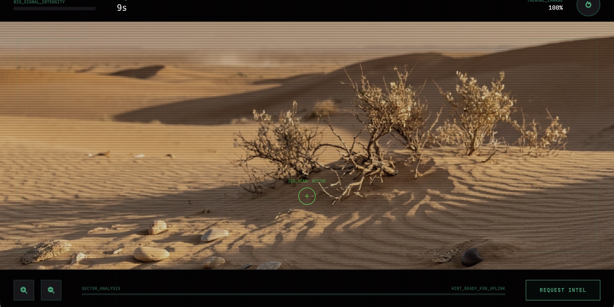
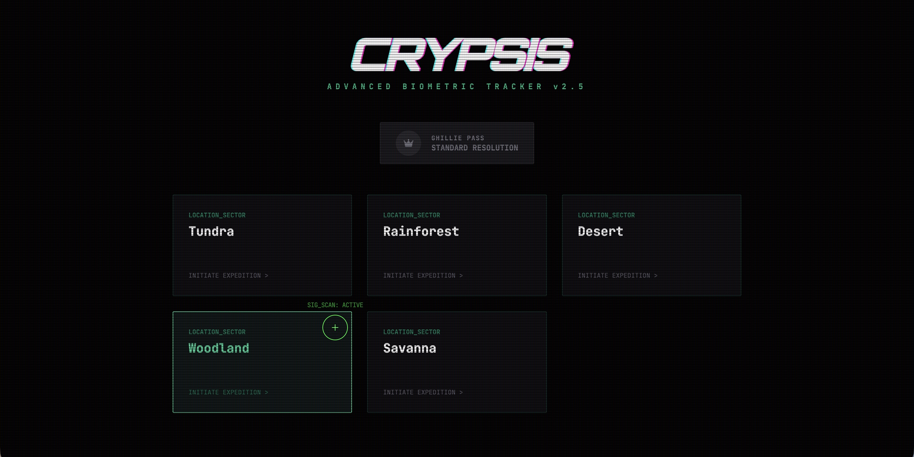
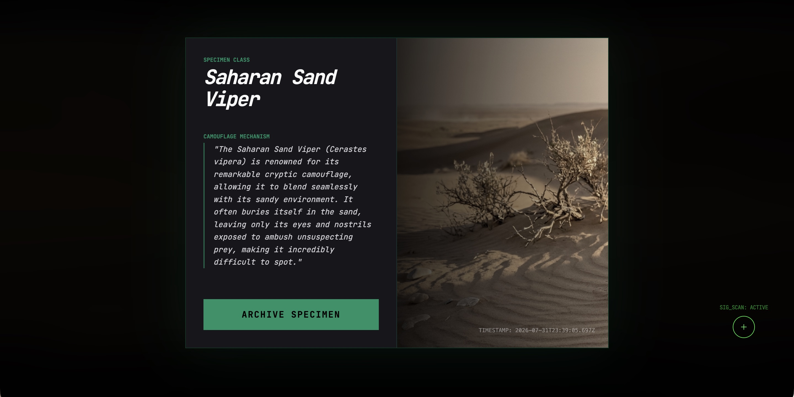

# Crypsis

AI-generated wildlife camouflage hunting game. Gemini creates a stunning nature photograph with a real animal hidden in it — your job is to find it before giving up and requesting intel.



## Quick Start

```bash
git clone https://github.com/andrewvoirol/crypsis.git
cd crypsis
npm install
npm run dev
```

> Requires a [Gemini API key](https://aistudio.google.com/apikey). Paste it into `.env.local` as `VITE_GEMINI_API_KEY=your_key_here`.

## How It Works

1. **Pick a biome** — Tundra, Rainforest, Desert, Woodland, or Savanna
2. **Gemini generates an image** of the biome with a camouflaged animal genuinely hidden in it
3. **Hunt** — move your cursor across the image. The signal strength bar rises as you get warmer. Click when signal is >85% to lock on
4. **Use your tools** — toggle thermal vision (limited charges), zoom in, or request progressive intel hints
5. **Discovery** — once found, you get a nature card with the animal's camouflage mechanism and a field-captured photo

The "Ghillie Pass" toggle on the start screen requests higher-resolution images for a harder challenge.



### Under the hood

Two-stage Gemini pipeline:
1. **Image generation** (`gemini-3-pro-image-preview`) — creates a photorealistic scene with the animal integrated into its natural habitat, not composited on top
2. **Structured analysis** (`gemini-2.5-flash`) — locates the animal's bounding box, generates progressive hints, a tactical field brief, and a biological camouflage fact — all returned as structured JSON

## Tech Stack

| Layer | Tech |
|-------|------|
| Framework | React 19 + Vite |
| Language | TypeScript |
| Styling | Tailwind CSS 3 + custom CSS (CRT scanlines, glitch effects) |
| AI | Google Gemini API (`@google/genai`) |
| Fonts | Orbitron, JetBrains Mono |

## License

MIT
